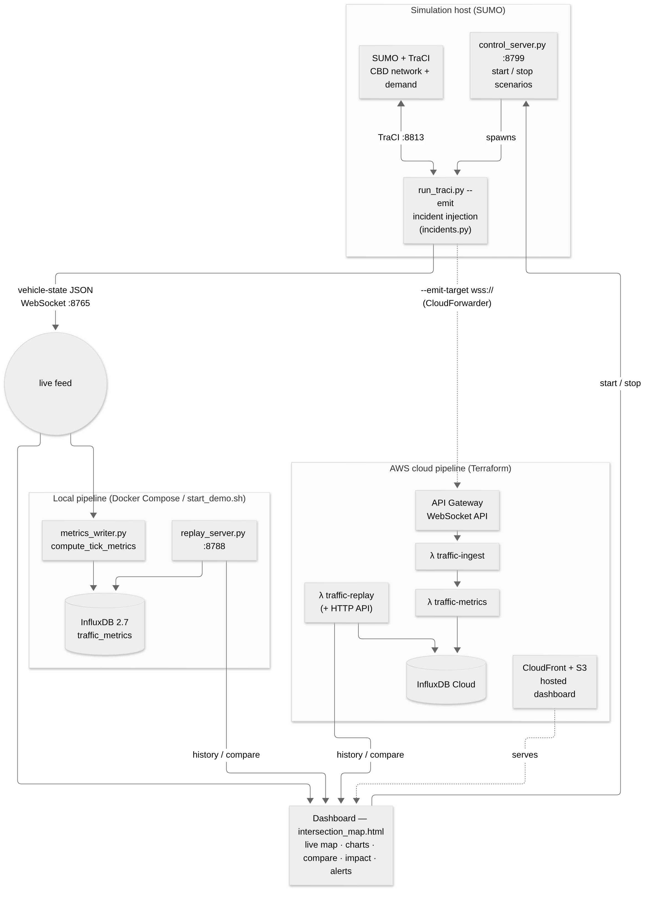

# Final Technical Report — Christchurch Smart-City Digital Twin

**COMP 693 Industry Project · Lincoln University, NZ**
Repository: `kyawzinmyolwin/demo_smart_city_digital_twin`

---

## 1. Executive summary

The project delivers a **decision-support traffic digital twin** of the
Christchurch central city. A calibrated SUMO micro-simulation — built from real
Christchurch City Council, OpenStreetMap, and Miovision data — streams live vehicle
state to a browser dashboard and to a cloud time-series pipeline. On top of that
real-time backbone, the twin can be **perturbed** (close a road, stage a crash, add
an event surge) and the impact **measured** against a real-data-calibrated baseline.

All core objectives from the proposal were met, and the headline extension feature
set was redirected mid-project (with rationale, §3) from passive historical replay to
active **what-if decision support** — the defining purpose of a digital twin. Both
committed Milestone-5 engineering deliverables (Docker Compose one-command demo and
GitHub Actions CI/CD) are complete, alongside documentation and this report.

**At a glance**

| Area | Outcome |
|---|---|
| Real-time emitter + WebSocket | Done, unit-tested, verified live |
| Cloud pipeline (AWS, Terraform) | Built, deployed, verified end-to-end |
| Live dashboard | Done + extended with decision-support panels |
| Decision-support features | Incident injection, scenario compare, impact report, congestion alerts, live click-to-inject |
| One-command demos | `docker compose up` and `start_demo.sh` |
| CI/CD | GitHub Actions, 86 tests green on Python 3.11 + 3.12 |
| Code | ~33 Python modules, 12 Terraform files, a 1,600-line dashboard, 86 unit tests |

---

## 2. Objectives (from the proposal)

The proposal set a 300-hour build across three phases plus an extension budget:

- **Phase 1 — real-time data:** extend the existing SUMO simulation to emit vehicle
  state as JSON over WebSocket every step.
- **Phase 2 — cloud pipeline:** a public WebSocket endpoint (AWS API Gateway), Lambda
  metrics aggregation, InfluxDB Cloud storage, infrastructure-as-code (Terraform), and
  a GitHub Actions CI/CD pipeline.
- **Phase 3 — live dashboard:** extend the existing Leaflet map with a WebSocket
  client, speed-coloured vehicle markers, three Chart.js panels (count / average speed
  / density), a pause/resume control, and static hosting (S3 + CloudFront / Pages).
- **Extension features (~100 h):** (1) congestion alerts, (2) scenario comparison,
  (3) historical replay, (4) threshold metrics panel, (5) Docker Compose one-command
  bring-up.

The simulation core (SUMO network, demand, `sim_pipeline.py`, the Unity 3D twin) was
**pre-existing and out of scope** — everything cloud-, data-, and dashboard-related
was built in this project. The network and demand are derived from real sources:
intersection counts and geometry from Christchurch City Council (n.d.), base road
geometry from OpenStreetMap contributors (n.d.), and turning-movement surveys from
Miovision (via the Council dataset).

---

## 3. Scope change: the decision-support pivot

**Decision (2026-09-16):** the Phase-2 extension work pivoted from a *historical
replay* twin to a *scenario / decision-support* twin.

**Rationale.** Replaying historical counts on the simplified intersection graph is
*estimation* over sparse, peak-only survey data with known connectivity gaps — hard to
defend as "real". Injecting incidents into the **strong, calibrated street-network
model** and measuring the result is (a) the actual point of a digital twin, (b)
honestly framed as synthetic, and (c) technically smaller, lower-risk work.

**What was kept, not dropped.** The counts → demand ETL pipeline remains as the
real-data-calibrated **baseline** that incidents are compared against, and as a
legitimate cloud-engineering showcase (S3 + Lambda ETL, tested).

**Mapping to the proposal.** The pivot *supersedes* two extension line items with
stronger equivalents and keeps the rest:

| Proposal extension item | Delivered as |
|---|---|
| (2) Scenario comparison | **Increment 2** — `scenario_id`-tagged metrics + dashboard compare view + impact report |
| (1) Congestion alerts | **Increment 3** — live congestion-alert overlay |
| (4) Threshold metrics panel | Folded into the congestion overlay |
| (3) Historical replay | De-prioritised (counts replay is now the baseline, not a headline); scrub bar deferred |
| (5) Docker Compose | **Delivered** (Milestone 5) |

The change was logged in `CLAUDE.md` and is recommended for confirmation with the
supervisor at a milestone review.

---

## 4. System architecture

One **producer** (SUMO + the TraCI emitter) feeds one of two interchangeable
**pipelines** — a local InfluxDB stack or the AWS cloud stack — and a single HTML
**dashboard** points at whichever endpoints it is given (Figure 1). Full data-flow,
local, and cloud deployment views plus a component/port reference are in
[ARCHITECTURE.md](ARCHITECTURE.md).



*Figure 1. System architecture. The producer (SUMO + `run_traci.py --emit`) streams
vehicle-state JSON over WebSocket to the dashboard and, in parallel, to a local
InfluxDB pipeline and/or the AWS cloud pipeline; the dashboard reads history from the
local replay server or the cloud replay Lambda.*

The per-tick metric computation (`compute_tick_metrics`) is a **pure function reused
verbatim** on both pipelines — a local module and the body of the `traffic-metrics`
Lambda — so local and cloud produce identical metrics.

---

## 5. Implementation

### 5.1 Real-time emitter (Phase 1)
`run_traci.py --emit` wraps the existing synchronous TraCI loop of SUMO (Lopez et al.,
2018) in an `asyncio` event loop and broadcasts a JSON snapshot per tick over
WebSocket (`:8765`); SUMO XY is converted to WGS84 via `sumolib`. New clients get an
immediate snapshot; tick rate is throttleable (`--emit-interval`). The serialiser
(`emitter.py::serialize_vehicles`) is unit-tested against a fake `traci` with no SUMO
dependency. The original non-emit behaviour is untouched.

### 5.2 Incident injection (Increment 1)
`incidents.py` models closures and perturbations (`close_edge`, `close_lane`,
`set_speed`, `add_vehicles`) with apply-and-revert semantics, driven by
`--close-edge`/`--incident-file`/`--scenario-id`. Supporting tooling: edge-picking
helpers (`list_edges.py`, `edges_geojson.py`) and a clickable road overlay on the map.

### 5.3 Metrics pipeline (Phase 2, local + cloud)
`metrics.py::compute_tick_metrics` (pure, unit-tested) computes vehicle count, average
speed, congestion index, and stopped/moving counts. `metrics_writer.py` consumes the
WebSocket feed and writes to InfluxDB (InfluxData, n.d.), tagged by `simId` **and**
`scenario_id`. `replay_server.py` is the local read endpoint (Flux range queries,
CORS, a validated `scenario` filter) — the dev mirror of the `traffic-replay` Lambda.

### 5.4 Dashboard (Phase 3 + decision-support)
`intersection_map.html` (~1,600 lines) extends the existing Leaflet map (Agafonkin,
n.d.) with: a WebSocket live layer (speed-coloured markers), three Chart.js panels
(Chart.js contributors, n.d.), pause/resume, a live sim clock, a **compare view** (two
`scenario_id` runs overlaid + quantified summary), an **impact report** (speed drop,
congestion rise, stopped mean/peak with directional Δ), a **congestion-alert overlay**,
and **click-to-inject** (close a road live, then a Close ↔ Reopen toggle to watch
recovery).

### 5.5 Scenario control & non-IT usability
`control_server.py` (`:8799`) starts/stops **named presets only** (never arbitrary
args) from the browser, and auto-starts the metrics writer so the GUI path fills
InfluxDB without a second terminal. Two one-command launchers wrap the whole local
stack: `start_demo.sh`/`stop_demo.sh` (host processes) and `docker compose up`
(containers — see §6).

### 5.6 Cloud infrastructure (Phase 2)
`infra/` (12 Terraform files; HashiCorp, n.d.) provisions a WebSocket API Gateway,
three Lambdas (ingest / metrics / replay), a DynamoDB connections table, S3 +
CloudFront dashboard hosting, Secrets Manager (InfluxDB token), and CloudWatch logs
with a \$5 billing alarm, in `ap-southeast-2` (Amazon Web Services, n.d.). Verified
end-to-end (live SUMO → API Gateway → Lambdas → InfluxDB Cloud). An optional,
cost-gated EC2 sim host can run the producer in AWS.

### 5.7 ETL baseline
`scripts/etl/` + `scenario_bridge.py` turn Council counts into calibrated
demand/baseline data, with S3 storage and ingest/query Lambdas — retained as the
real-data comparison path (45 unit tests, AWS mocked with `moto`).

---

## 6. Milestone 5 engineering deliverables

- **Docker Compose one-command demo.** `docker compose up` builds a SUMO image
  (`ppa:sumo/stable`, the recipe proven in `sim_host.tf`) and a slim Python image, then
  runs InfluxDB + sim + writer + replay + dashboard, with code/data bind-mounted
  (Docker, Inc., n.d.). Guide: [DOCKER.md](../DOCKER.md).
- **GitHub Actions CI/CD.** `.github/workflows/ci.yml` runs the full unit suite on
  every push and pull request across a Python 3.11 + 3.12 matrix (test deps pinned in
  `requirements-dev.txt`, pip-cached). A second workflow publishes the dashboard to
  GitHub Pages.

---

## 7. Evaluation against proposal goals

| Objective | Status | Evidence |
|---|---|---|
| P1 — JSON/WebSocket emitter, every step, configurable rate | ✅ Met | `run_traci.py --emit`, `emitter.py`; 6 tests |
| P2 — API Gateway WebSocket endpoint | ✅ Met | `infra/api_gateway.tf`; verified |
| P2 — Lambda metrics aggregation | ✅ Met | `traffic-metrics` λ = `compute_tick_metrics`; 6 tests |
| P2 — InfluxDB Cloud storage | ✅ Met | writes verified (local + cloud) |
| P2 — Infrastructure as code (Terraform) | ✅ Met | 12 `.tf` files, applied |
| P2 — GitHub Actions CI/CD | ✅ Met | `ci.yml`, 86 tests, 3.11+3.12 |
| P3 — WebSocket client + speed-coloured markers | ✅ Met | `intersection_map.html` |
| P3 — Three Chart.js panels | ✅ Met | count / avg speed / congestion |
| P3 — Pause/resume | ✅ Met | live control |
| P3 — Static hosting (S3/CloudFront + Pages) | ✅ Met | `cdn.tf`, `deploy-dashboard.yml` |
| Ext 1 — Congestion alerts | ✅ Met | congestion overlay (Inc 3) |
| Ext 2 — Scenario comparison | ✅ Exceeded | compare view + **impact report** (Inc 2/4) |
| Ext 3 — Historical replay (scrub bar) | ⚠️ Deferred | superseded by the pivot; counts replay is the baseline |
| Ext 4 — Threshold metrics panel | ✅ Folded | into the congestion overlay |
| Ext 5 — Docker Compose | ✅ Met | `docker-compose.yml`, `docker/` |
| Beyond proposal | ➕ Added | incident injection, live click-to-inject + recovery, GUI scenario control, impact report, ETL baseline bridge, one-command launchers |

**Summary:** every core objective met; the extension set delivered as a stronger
decision-support feature set, with one proposal item (historical replay scrub bar)
deliberately deferred by the pivot and several capabilities added beyond the proposal.

---

## 8. Results — scenario outcomes

The objective measure of the twin's core purpose is whether an injected incident
produces a measurable, directionally-correct impact against the calibrated baseline.
Each scenario below was run from the morning peak (sim start 06:30), its per-tick
metrics written to InfluxDB tagged by `scenario_id`, and the baseline-vs-incident
deltas computed by the dashboard impact report (and reproduced on the command line by
`scripts/capture_results.py` — see *Reproducing the results* below).

> **Note — to be populated from a run on the simulation host.** The values below are
> placeholders («…»); run the three preset scenarios and paste the captured figures.
> The method, table, and figures are in place so the evidence slots straight in.

**Table 1. Baseline vs incident impact (morning peak).**

| Scenario | Avg speed (km/h) | Δ speed | Congestion index | Δ congestion | Stopped (mean / peak) | Vehicles (mean) |
|---|---|---|---|---|---|---|
| Baseline (`baseline_am`) | «…» | — | «…» | — | «…» / «…» | «…» |
| Crash — arterial closed (`crash_arterial`) | «…» | «−…%» | «…» | «+…» | «…» / «…» | «…» |
| Roadworks — reduced speed (`roadworks`) | «…» | «−…%» | «…» | «+…» | «…» / «…» | «…» |

*Interpretation (to confirm against the figures): a larger speed drop and congestion
rise indicate a more disruptive incident; the arterial closure is expected to be the
most severe, with recovery visible after the road is reopened.*

**Figures (to capture from the running dashboard):**

- *Figure 2. Live dashboard — speed-coloured vehicles on the CBD map with the three
  live metric panels.*
- *Figure 3. Compare view — baseline vs incident overlaid for a chosen metric, with the
  quantified summary line.*
- *Figure 4. Impact report — the baseline-vs-incident table with directional deltas.*
- *Figure 5. Congestion-alert overlay — slow segments flagged red on the road network.*

**Reproducing the results.** With the stack running (`docker compose up`, or
`start_demo.sh`), start each preset from the dashboard, let it run, then:

```bash
python scripts/capture_results.py --replay http://localhost:8788/metrics \
  --scenarios baseline_am,crash_arterial,roadworks
```

This prints Table 1 as Markdown (means, peaks, and deltas vs the baseline), ready to
paste. Screenshots for Figures 2–5 are taken from the dashboard panels.

---

## 9. Testing & quality

- **86 unit tests**, all green on Python 3.11 and 3.12:
  - 41 core (`scripts/tests/`): incidents (14), control_server (11), emitter (6),
    metrics (6), replay_server (4).
  - 45 ETL (`scripts/etl/tests/`): scenario bridge (9), counts ETL (7), ingest (7),
    query (6), drive client (6), lambda query (4), lambda ingest (3), s3 store (3).
- **Pure-core / thin-glue** design: business logic is tested against fakes (`traci`,
  `Popen`) and mocks (`moto` for AWS) — no SUMO, cloud, or network needed in CI.
- Dashboard JavaScript is syntax-checked with `node --check`.
- CI enforces the suite on every push and pull request.

---

## 10. Engineering practices

Infrastructure-as-code (Terraform) with least-privilege IAM and no hard-coded secrets
(Secrets Manager); one logical change per commit with a consistent attribution footer;
feature-branch workflow; cost controls (billing alarm, cost-gated sim host); layered
documentation (`README`, `ARCHITECTURE`, `DOCKER`, `METRICS_REPLAY`, `running_guide`,
`infra/README`, `CHECKLIST`, `CLAUDE.md`).

---

## 11. Known limitations & honest caveats

- **Incidents are synthetic.** The twin perturbs a calibrated model; it does not
  ingest live road-sensor data (the Council sources are download-only).
- **A "closed" edge is a hard speed cap, not rerouting.** Traffic queues/crawls rather
  than diverting; incident rerouting is scoped and deferred (§13).
- **Cloud click-to-inject is local-only.** Live injection works over the local
  WebSocket; driving it from the hosted dashboard needs a cloud control path (deferred).
- **Replay public URL.** A Lambda Function URL 403s anonymously on this account; the
  dashboard uses an API-Gateway-fronted replay instead.
- **Docker `sim` image** is validated with `docker compose config` and uses the proven
  SUMO recipe, but a full container build/run should be exercised on the target VM.
- **Compare uses per-series aggregates**, not timestamp alignment (the two runs occur
  at different wall-clock times) — appropriate for the metrics compared.

---

## 12. Reflection & skills developed

**New skills developed.** The project took me well beyond my starting point. On the
simulation side I learned to drive SUMO in real time through TraCI and to stream
coordinate-converted state asynchronously with Python `asyncio`/`websockets`. On the
cloud side I built, from scratch, a serverless pipeline (API Gateway WebSocket API,
Lambda, DynamoDB, S3/CloudFront, Secrets Manager) and provisioned all of it as code
with Terraform — infrastructure-as-code, least-privilege IAM, and cost controls were
new to me. I also learned time-series modelling in InfluxDB (tags vs fields, Flux
range queries), containerised the whole stack with Docker Compose, and set up CI with
GitHub Actions.

**What I found most valuable.** The strongest lesson was non-technical: recognising
mid-project that replaying historical counts was hard to defend as "real", and
re-aiming the work at *what-if decision support* on the calibrated model. Framing the
synthetic incidents honestly — and keeping the real-data pipeline as a baseline rather
than discarding it — taught me to make and defend a scope decision on engineering and
academic merit, not sunk cost.

**What was hard.** Getting SUMO running from source, debugging a Lambda Function URL
that returned 403 to anonymous requests, keeping the local and cloud metric paths
identical (solved by reusing one pure function), and the networking details of running
services inside a VM (binding `0.0.0.0` for port-forwarding, Docker socket
permissions). Each of these pushed my debugging and systems knowledge.

**What I would do differently.** Capture quantified scenario results earlier rather
than at the end, and stand up the hosted deployment continuously instead of in a final
push — both would have given evidence to iterate against sooner.

**Areas for continued development.** Incident rerouting for realistic diversion,
a cloud control path so the hosted dashboard is fully interactive, load/performance
testing of the pipeline, and front-end polish. These are the natural next steps (§13).

---

## 13. Future work

- Incident **rerouting / detours** (TraCI `adaptTraveltime` + `rerouteTraveltime`,
  `--time-to-teleport -1`), ~6–9 h.
- **Cloud control path** for click-to-inject (API Gateway control route + SSM).
- Impact report **v2**: true per-vehicle delay (`traci.vehicle.getTimeLoss`) and
  affected-area; recovery-time after reopen.
- Portfolio wrap-up: dashboard screenshots + live-demo URL in the README, and a
  2-minute demo recording.

---

## 14. Conclusion

The project delivers a working, cloud-connected, tested, and reproducibly deployable
decision-support digital twin of Christchurch's central-city traffic. It meets the
proposal's core objectives and re-aims the extension work at genuine what-if decision
support — the substance of a digital twin — while retaining the real-data pipeline as a
calibrated baseline. The engineering deliverables (one-command demos, CI across two
Python versions, infrastructure-as-code, and layered documentation) make it both
demonstrable and defensible as an industry-project portfolio piece.

---

## 15. References

*Referencing follows APA 7th edition, per Lincoln University Library and Teaching &
Learning guidance.*

Agafonkin, V. (n.d.). *Leaflet: An open-source JavaScript library for mobile-friendly
interactive maps*. Retrieved October 12, 2026, from https://leafletjs.com/

Amazon Web Services. (n.d.). *AWS documentation*. Retrieved October 12, 2026, from
https://docs.aws.amazon.com/

Chart.js contributors. (n.d.). *Chart.js documentation*. Retrieved October 12, 2026,
from https://www.chartjs.org/docs/latest/

Christchurch City Council. (n.d.). *Intersection traffic counts database*. Retrieved
October 12, 2026, from https://ccc.govt.nz/transport/improving-our-transport-and-roads/traffic-count-data/intersection-traffic-counts-database

Docker, Inc. (n.d.). *Docker documentation*. Retrieved October 12, 2026, from
https://docs.docker.com/

German Aerospace Center (DLR). (n.d.). *SUMO documentation*. Retrieved October 12,
2026, from https://sumo.dlr.de/docs/

HashiCorp. (n.d.). *Terraform documentation*. Retrieved October 12, 2026, from
https://developer.hashicorp.com/terraform/docs

InfluxData. (n.d.). *InfluxDB OSS documentation*. Retrieved October 12, 2026, from
https://docs.influxdata.com/influxdb/v2/

Lopez, P. A., Behrisch, M., Bieker-Walz, L., Erdmann, J., Flötteröd, Y.-P., Hilbrich,
R., Lücken, L., Rummel, J., Wagner, P., & Wießner, E. (2018). Microscopic traffic
simulation using SUMO. In *2018 21st International Conference on Intelligent
Transportation Systems (ITSC)* (pp. 2575–2582). IEEE.
https://doi.org/10.1109/ITSC.2018.8569938

OpenStreetMap contributors. (n.d.). *OpenStreetMap*. Retrieved October 12, 2026, from
https://www.openstreetmap.org/

---

*Status detail: [CHECKLIST.md](../CHECKLIST.md) · Architecture: [ARCHITECTURE.md](ARCHITECTURE.md) · Decisions & history: [CLAUDE.md](../CLAUDE.md)*
