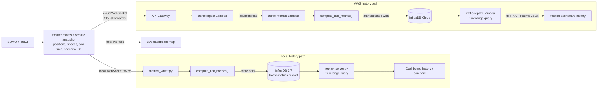

# Metrics data-flow — snapshot to history

How a vehicle snapshot from the simulation becomes stored time-series metrics and
is read back by the dashboard. One producer (SUMO + the TraCI emitter) feeds two
interchangeable history paths — a **local** path (InfluxDB 2.7 + `replay_server.py`)
and an **AWS** path (API Gateway + Lambdas + InfluxDB Cloud) — while the live map is
driven straight off the local WebSocket feed.

Both paths run the **same** aggregation (`compute_tick_metrics()`); the metrics Lambda
keeps a copy of that function in sync with the local writer. See also
[`ARCHITECTURE.md`](ARCHITECTURE.md) for the system-wide views.

**Component reference**

| Node | Where it lives |
|---|---|
| Emitter snapshot | `scripts/emitter.py` (`serialize_vehicles`, `CloudForwarder`) via `run_traci.py --emit` |
| `metrics_writer.py` | `scripts/metrics_writer.py` — local WS feed → aggregate → InfluxDB |
| `compute_tick_metrics()` | `scripts/metrics.py` (local) and `infra/functions/traffic_metrics/handler.py` (cloud, kept in sync) |
| `replay_server.py` | `scripts/replay_server.py` — local read endpoint (Flux range query, CORS) |
| API Gateway + Lambdas | `infra/` (WebSocket API, `traffic-ingest` / `traffic-metrics` / `traffic-replay`) |
| InfluxDB | local Docker (2.7) vs InfluxDB Cloud — the Lambda writes to Cloud, not `localhost` |

**Note on the two clocks:** each stored point carries a row timestamp (wall-clock *write*
time, which keeps separate runs from colliding) and a `simTime` field (the simulation clock
the dashboard plots against). The history/compare views read back on `simTime`.
