# System flow & troubleshooting map

A labelled map of the whole system, for pinpointing where something breaks. When you hit a
problem, find the **zone (①–⑤)** and the **edge (port/protocol)** in the diagram, then look it
up in the troubleshooting table — or just tell me the zone + edge and I'll know exactly which
component and port is involved.

```mermaid
flowchart LR
  subgraph PROD["① Producer — SUMO host / EC2 sim host"]
    SUMO["SUMO<br/>TraCI :8813"]
    RT["run_traci.py<br/>--emit / --emit-target"]
    EM["emitter.py<br/>WS server :8765<br/>+ ControlInbox"]
    CF["CloudForwarder"]
    INC["incidents.py<br/>IncidentController"]
    SUMO <-->|"TraCI :8813"| RT
    RT --> EM
    RT --> CF
    RT --> INC
  end
  subgraph LOCAL["② Local stack (laptop / VM)"]
    MW["metrics_writer.py<br/>compute_tick_metrics()"]
    IDB[("InfluxDB 2.7<br/>:8086")]
    RS["replay_server.py<br/>:8788"]
    CS["control_server.py<br/>:8799"]
    MW --> IDB
    IDB -->|"Flux :8086"| RS
  end
  subgraph CLOUD["③ AWS cloud (ap-southeast-2)"]
    WSAPI["API Gateway<br/>WebSocket /prod"]
    ING["traffic-ingest λ"]
    DDB[("DynamoDB<br/>connections")]
    MET["traffic-metrics λ<br/>compute_tick_metrics()"]
    ICLOUD[("InfluxDB Cloud")]
    RAPI["API Gateway HTTP<br/>/metrics (replay)"]
    REP["traffic-replay λ"]
    CAPI["API Gateway HTTP<br/>control"]
    AUTH["control-authorizer λ<br/>(shared token)"]
    CTRL["traffic-control λ"]
    SSM["AWS SSM"]
    S3H["S3 + CloudFront<br/>dashboard + data host"]
    SEC[["Secrets Manager<br/>InfluxDB + control tokens"]]
    CW["CloudWatch logs<br/>+ $5 billing alarm"]
    WSAPI --> ING
    ING -->|"register / fan-out"| DDB
    ING -->|"async invoke"| MET
    MET --> ICLOUD
    RAPI --> REP
    REP -->|"Flux"| ICLOUD
    CAPI --> AUTH
    AUTH --> CTRL
    CTRL --> SSM
  end
  subgraph DASH["④ Browser dashboard (Leaflet + Chart.js)"]
    LIVE["Live vehicle map"]
    HIST["History / Compare / Impact"]
    SCN["Scenario-control panel<br/>+ Close/Reopen"]
  end
  subgraph ETL["⑤ ETL / model build (offline)"]
    GD[("CCC Google Drive<br/>count workbooks")]
    DC["drive_client.py"]
    CE["counts_etl.py"]
    S3E[("S3 raw / processed<br/>+ manifest")]
    SB["scenario_bridge.py"]
    DEM["demand CSV → duarouter<br/>→ *.rou.xml"]
    QAPI["query API<br/>→ lambda_query"]
    GD -->|"HTTPS API key"| DC --> CE --> S3E --> SB --> DEM
    S3E --> QAPI
  end
  EM -->|"live WS :8765"| LIVE
  EM -->|"WS :8765"| MW
  RS -->|"HTTP :8788"| HIST
  SCN -->|"HTTP :8799 (local)"| CS
  CS -->|"spawns"| RT
  CS -->|"spawns"| MW
  LIVE -.->|"control WS :8765"| EM
  CF -->|"wss /prod"| WSAPI
  WSAPI -->|"fan-out WS"| LIVE
  HIST -->|"HTTPS ?replay="| RAPI
  SCN -->|"HTTPS + token"| CAPI
  SSM -->|"rewrite env + restart"| RT
  S3H -->|"HTTPS static + data"| DASH
  MET -.->|"token"| SEC
  REP -.->|"token"| SEC
  CTRL -.->|"token"| SEC
  DEM -.->|"feeds baseline"| SUMO
  classDef prod fill:#e4f2f2,stroke:#0e7c7b,color:#123;
  classDef local fill:#e8eef7,stroke:#33527a,color:#123;
  classDef cloud fill:#fdf1e0,stroke:#b5742a,color:#123;
  classDef dash fill:#eaf5ec,stroke:#2a9d8f,color:#123;
  classDef etl fill:#f1f3f5,stroke:#667,color:#123;
  class SUMO,RT,EM,CF,INC prod;
  class MW,IDB,RS,CS local;
  class WSAPI,ING,DDB,MET,ICLOUD,RAPI,REP,CAPI,AUTH,CTRL,SSM,S3H,SEC,CW cloud;
  class LIVE,HIST,SCN dash;
  class GD,DC,CE,S3E,SB,DEM,QAPI etl;
```

> Static render (if your viewer doesn't render Mermaid): [`img/system_flow.png`](img/system_flow.png)

## Ports at a glance

| Port | Service | Where |
|---|---|---|
| **8813** | SUMO TraCI | producer |
| **8765** | emitter WebSocket (live feed + control inbox) | producer |
| **8086** | InfluxDB 2.7 | local |
| **8788** | replay_server (history read) | local |
| **8799** | control_server (scenario start/stop) | local |
| `/prod` | API Gateway WebSocket (cloud ingest + fan-out) | cloud |
| HTTPS | API Gateway HTTP (replay `?replay=`, control `?control=&token=`) | cloud |

## Troubleshooting reference — link → symptom → check

| # | Link / component | Usual symptom | First thing to check |
|---|---|---|---|
| ① | SUMO ↔ run_traci (TraCI :8813) | sim won't start / "connection refused" | `SUMO_HOME` set; SUMO on PATH; port 8813 free |
| ① | emitter first broadcast crashes | crash on first tick | `pyproj` installed (needed by `sumolib.convertXY2LonLat`) — run from the venv with `requirements.txt` |
| ① | run_traci → emitter (WS :8765) | nothing on the live map | `--emit` passed; serving map on **8000**, not 8765; emitter host `0.0.0.0` for VM forwarding |
| ①→③ | CloudForwarder → API Gateway (wss /prod) | cloud feed silent | `--emit-target wss://…/prod`; snapshot wrapped as `{"action":"sendmessage",…}`; snapshot < 128 KB; throttle with `--emit-interval` |
| ② | emitter → metrics_writer (WS :8765) → InfluxDB | live map works but **History/Compare empty** | the "forgot the writer" trap — start `metrics_writer.py` (or use `control_server`/`run_scenarios.py`, which auto-start it) |
| ② | metrics_writer → InfluxDB :8086 | writer errors / no points | InfluxDB up (`docker compose up -d`); `INFLUXDB_*` env / token correct; bucket `traffic-metrics` |
| ② | replay_server :8788 → InfluxDB | History panel won't load (local) | replay_server running; `?replay=http://localhost:8788/metrics`; time range covers the run |
| ②/③ | **two clocks** | charts flat / wrong time axis | History plots on `simTime` (a field), not the wall-clock row timestamp — set the range to the sim window |
| ③ | API Gateway WS → ingest λ → fan-out | hosted live map blank | browser connected to the WS API; `$connect` registered in DynamoDB; ingest λ logs in CloudWatch |
| ③ | ingest → metrics λ → InfluxDB Cloud | no cloud history | metrics λ async-invoked; InfluxDB **Cloud** token in Secrets Manager (NOT the local `.env` token); region ap-southeast-2 |
| ③ | replay λ (Function URL) | hosted history 403 | use the **API Gateway** `?replay=` endpoint, not the Lambda Function URL (anonymous 403 on this account) |
| ③ | control: CAPI → authorizer → control λ → SSM | Start/Stop does nothing (hosted) | `?control=<api>&token=<token>`; token matches; sim host **already running** (/start switches scenario, doesn't boot EC2) |
| ③ | S3 + CloudFront host | "Could not load intersection_geo.csv" / 404 | `deploy_dashboard.sh` uploads HTML + `edges.geojson` + `data/output/intersection_geo.csv`; invalidate CloudFront |
| ④ | live map lag / choppy | perceived "laggy" | not CloudFront — it's render + message rate; canvas renderer + lower `--speed` (see CHECKLIST "Live-feed latency") |
| ④ | Close/Reopen live | click does nothing | **local path only** (cloud uses "Start road block"); emitter has `ControlInbox`; command is `{action:"incident"/"reopen"}` over WS :8765 |
| ④ | Compare "better/worse" looks wrong | crash shows *lower* congestion | not a bug — insertion backlog; read congestion with throughput (see `docs/Q&A.md` Q7) |
| ⑤ | Drive → drive_client (HTTPS) | ingest finds no files | Drive folder public; API key valid; manifest change-detection (only new/changed downloaded) |
| ⑤ | counts_etl parse | a workbook "rejected" | expected for non-vehicle files (pedestrian/template) — rejection is by design, not a crash |
| ⑤ | ETL tests (moto) | ETL tests fail on a fresh box | moto-version env issue — pins in `requirements-dev.txt`; CI is green |
| ③ | Secrets Manager destroy→apply | Lambda chain fails to create | 7-day recovery window blocks same-name secret — `recovery_window_in_days = 0` or `--force-delete-without-recovery` |

> **How to ask me:** "Zone ③, the replay λ edge is 403" or "live map blank, cloud path" — naming
> the zone + edge (and local vs cloud) points me straight at the component, port and likely cause.
